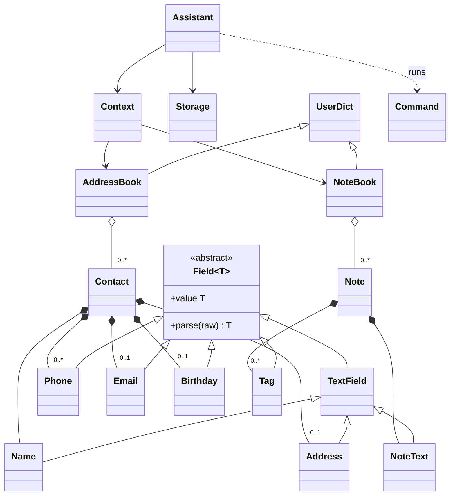

# Personal Assistant

[](https://github.com/nekipa12/goit-pycore-final-project/actions/workflows/ci.yml)

A command-line personal assistant that keeps an address book with
birthdays and a notebook with tags. Final project of the course
*Python Programming: Foundations and Best Practices* (GoIT / Neoversity).

- **Contacts**: name, several phone numbers, email, birthday and address;
  add, search, edit and delete.
- **Birthdays**: who has a birthday from today up to N days ahead.
- **Validation**: every field is checked on create *and* on edit, with
  a clear message about what is wrong.
- **Notes**: add, search, edit and delete text notes.
- **Tags** (bonus): add and remove tags, search notes by tags, show notes
  sorted by tag.
- **Storage**: the data lives in your home folder, is saved after every
  change and survives restarts.
- **CLI**: `help` lists every command with its usage, Tab completes
  command names, and a mistyped command gets a suggestion.

```text
assistant> add-contact Anna Kovalenko phone=067 123 45 67 birthday=26.11.1990
Contact 'Anna Kovalenko' added.
assistant> birthdays
        Birthdays from 24.11.2026 to 01.12.2026
┏━━━━━━━━━━━━━━━━┳━━━━━━━━━━━━┳━━━━━━━━━━━━┳━━━━━━━━━━┓
┃ Name           ┃ Born       ┃ Birthday   ┃ Weekday  ┃
┡━━━━━━━━━━━━━━━━╇━━━━━━━━━━━━╇━━━━━━━━━━━━╇━━━━━━━━━━┩
│ Anna Kovalenko │ 26.11.1990 │ 26.11.2026 │ Thursday │
└────────────────┴────────────┴────────────┴──────────┘
```

## Installation

You need **Python 3.10 or newer**. After installation the command
`personal-assistant` works from any folder.

### Recommended: pipx

[pipx](https://pipx.pypa.io/) installs command-line apps into their own
isolated environment and puts the command on your `PATH`.

```bash
pipx install git+https://github.com/nekipa12/goit-pycore-final-project.git
personal-assistant
```

From a cloned copy of the repository, `pipx install .` does the same.
If `personal-assistant` is not found afterwards, run `pipx ensurepath`
and open a new terminal.

### Alternative: a virtual environment

macOS / Linux:

```bash
git clone https://github.com/nekipa12/goit-pycore-final-project.git
cd goit-pycore-final-project
python3 -m venv .venv
source .venv/bin/activate
python -m pip install .
personal-assistant
```

Windows (PowerShell):

```powershell
git clone https://github.com/nekipa12/goit-pycore-final-project.git
cd goit-pycore-final-project
py -m venv .venv
.venv\Scripts\Activate.ps1
python -m pip install .
personal-assistant
```

Notes:

- On Homebrew Python (macOS) and recent Debian/Ubuntu, `pip install`
  outside a virtual environment stops with *externally-managed-environment*
  (PEP 668). Use pipx or a virtual environment as shown above.
- If PowerShell refuses to run `Activate.ps1`, run
  `Set-ExecutionPolicy -Scope CurrentUser RemoteSigned` once.
- `python -m personal_assistant` starts the same program.

## Usage

Start `personal-assistant` and type commands at the `assistant>` prompt.
`help` lists every command with its usage. `exit` quits, and so do
Ctrl+D and Ctrl+C: every change is already saved. Tab completes command
names, and the arrow keys bring back earlier commands.

How to type values:

- Names may contain spaces: `delete-contact Anna Kovalenko`. Letter case
  does not matter: `delete-contact anna kovalenko` finds the same contact.
- Fields are written as `field=value`. A value runs until the next
  `field=`, so quotes are optional:
  `add-contact Anna phone=067 123 45 67 address=Kyiv, Khreshchatyk St 1`.
- Double quotes group words if you prefer: `address="Kyiv, Main St 1"`.
  Apostrophes need no special care: `add-contact Mar'yana`.
- Everything after `add-note`, `edit-note <id>` and `search-notes` is
  taken exactly as typed, quotes included.
- A command typed with wrong arguments prints its usage line.

### Contacts

| Command | What it does | Example |
| --- | --- | --- |
| `add-contact <name> [phone=…]… [email=…] [birthday=…] [address=…]` | Add a contact; only the name is required, `phone=` may repeat | `add-contact Anna Kovalenko phone=0671234567 email=anna@example.com birthday=24.11.1990 address=Kyiv` |
| `edit-contact <name> [name=…] [email=…] [birthday=…] [address=…]` | Change fields; an empty value (`address=`) clears a field | `edit-contact Anna Kovalenko email=anna@work.com` |
| `add-phone <name> <phone>` | Add one more phone | `add-phone Anna Kovalenko 050-123-45-67` |
| `edit-phone <name> <old> <new>` | Replace a phone | `edit-phone Anna Kovalenko 0501234567 0631234567` |
| `remove-phone <name> <phone>` | Remove a phone | `remove-phone Anna Kovalenko 0631234567` |
| `contacts` | List all contacts | `contacts` |
| `search-contacts <text>` | Search all fields, or one with `field=text` | `search-contacts 067 123`, `search-contacts email=gmail` |
| `delete-contact <name>` | Delete a contact | `delete-contact Anna Kovalenko` |

Write a phone number without spaces (or in quotes) in `add-phone`,
`edit-phone` and `remove-phone`, because the last word is the phone.

### Birthdays

| Command | What it does | Example |
| --- | --- | --- |
| `birthdays [days]` | Birthdays from today up to `days` days ahead, 0 to 365, 7 by default | `birthdays 30` |

The period includes both ends: `birthdays 0` shows today's birthdays,
`birthdays 7` shows today and the next seven days. Each row shows the
date of the coming birthday and its day of the week. People born on
29 February celebrate on 1 March in non-leap years.

### Notes and tags

| Command | What it does | Example |
| --- | --- | --- |
| `add-note <text>` | Add a note; it gets the next number | `add-note Buy a gift for Anna's birthday` |
| `notes` | List all notes | `notes` |
| `edit-note <id> <text>` | Replace the text | `edit-note 3 Buy a gift and flowers` |
| `delete-note <id>` | Delete a note | `delete-note 3` |
| `search-notes <text>` | Search text and tags, ignoring case | `search-notes gift` |
| `add-tag <id> <tag>…` | Add tags to a note | `add-tag 3 family #gift` |
| `remove-tag <id> <tag>…` | Remove tags from a note | `remove-tag 3 gift` |
| `search-tags <tag>…` | Notes that have **all** the given tags | `search-tags work urgent` |
| `notes-by-tag` | Notes sorted by tag, untagged notes last | `notes-by-tag` |

A new note gets the number after the largest one in use. `#3` works as
well as `3`.

### General

| Command | What it does |
| --- | --- |
| `help` | All commands with their usage |
| `exit` | Quit; every change is already saved |

## Field rules

| Field | Accepted | Stored as |
| --- | --- | --- |
| Name | 1–50 characters, any letters, digits and punctuation; unique ignoring case | trimmed, inner spaces collapsed |
| Phone | Ukrainian numbers: `+380XXXXXXXXX`, `380XXXXXXXXX` or `0XXXXXXXXX`; spaces, dashes and brackets allowed | `+380XXXXXXXXX` |
| Email | `name@domain.tld` | as typed, without surrounding spaces |
| Birthday | `DD.MM.YYYY`, a real date from 01.01.1900 to today | `DD.MM.YYYY` |
| Address | 1–120 characters | trimmed, inner spaces collapsed |
| Note text | 1–1000 characters | trimmed, inner spaces collapsed |
| Tag | one word of letters, digits, `-` or `_`; a leading `#` is optional | lower case, without `#` |

A contact cannot have the same phone twice, in any format.

## Where the data is stored

All data is kept in one file in your home folder, whatever folder you
start the program from:

| System | File |
| --- | --- |
| macOS, Linux | `~/.personal_assistant/data.json` |
| Windows | `C:\Users\<you>\.personal_assistant\data.json` |

The program prints the exact path when it starts. Set the environment
variable `PERSONAL_ASSISTANT_DATA_DIR` to keep the file in another
folder, for example for a demo.

The file is saved after every command that changes something. A save
writes a temporary file first and then puts it in place of the old one,
so a crash never leaves a half-written file. If the file cannot be read
(for example after a manual edit), the program stops with a message and
leaves the file as it is. To back up your data, copy the file.

## Development

```bash
python3 -m venv .venv
source .venv/bin/activate            # Windows: .venv\Scripts\Activate.ps1
python -m pip install -e ".[dev]"
pre-commit install                   # run the checks before every commit
```

| Check | Command |
| --- | --- |
| Tests | `pytest` |
| Lint (PEP 8, imports, docstrings) | `ruff check .` |
| Formatting | `ruff format --check .` |
| PEP 8 with default flake8 settings, 79 columns | `flake8 src tests` |
| Types | `mypy` |

GitHub Actions runs all of them on every push and pull request, with
the tests on Linux and Windows and on Python 3.10 and the latest Python.

### Project structure

```text
src/personal_assistant/
├── __init__.py   version
├── __main__.py   `python -m personal_assistant`
├── cli.py        the loop that reads and runs commands, main()
├── commands.py   one function per command, registered in COMMANDS
├── parser.py     splitting lines into words and field=value pairs
├── fields.py     validated fields: Name, Phone, Email, Birthday, Address, …
├── contacts.py   Contact and AddressBook
├── notes.py      Note and NoteBook
├── storage.py    the JSON file in the home folder
├── views.py      rich tables for the output
└── errors.py     error classes with messages for the user
tests/            pytest suite, including runs of the installed command
```

### Design



- **Inheritance.** Every field derives from the abstract `Field`, which
  owns comparison, hashing and printing. A subclass only defines `parse()`,
  which normalizes and validates the raw text (the template method
  pattern). The free-text fields share `TextField`. `AddressBook` and
  `NoteBook` extend `UserDict`. All expected errors derive from
  `AssistantError`.
- **Composition.** A `Contact` is made of field objects, and so is a `Note`.
  The books hold contacts and notes. `Assistant` is given the storage,
  the books and the console.
- **Immutable fields.** A field never changes after creation; editing
  creates a new field, so an edit runs exactly the same validation as a
  new entry.
- **Commands.** Each command is a function registered with the `@command`
  decorator together with its usage line. `help`, Tab completion and typo
  suggestions all come from the `COMMANDS` registry, and adding a command
  never touches the main loop.
- **Errors.** Handlers raise `AssistantError` subclasses; the loop prints
  their message and goes on, and an error without a message prints the
  usage of the command. Any other exception is reported as an unexpected
  error, so a bug can never close the program.

## How the acceptance criteria are met

| Criterion | Where |
| --- | --- |
| Public GitHub repository | this repository |
| Comments, documentation, install and usage guide | docstrings in every module, this README |
| Installable package, callable from anywhere | `pyproject.toml` entry point `personal-assistant`; `tests/test_cli.py` runs the installed command from other folders |
| All requirements implemented | commands above; `tests/test_commands.py` |
| Command-line interface with typed commands | `cli.py`, `commands.py` |
| Convenient, logical interface | `help` with usage lines, Tab completion, typo suggestions, a hint for a phone typed without `phone=` |
| Loop until an exit command | `Assistant.run()` in `cli.py` |
| Data saved and kept after restart | `storage.py`; `tests/test_storage.py`, `tests/test_cli.py` |
| No errors while running; bad input never closes the program | error classes plus a last-resort handler in `Assistant.execute()`; `tests/test_cli.py::test_bad_input_never_crashes` |
| OOP, inheritance and composition | see [Design](#design) |
| Validation of every field | `fields.py`, [Field rules](#field-rules); `tests/test_fields.py` |
| Clean code, PEP 8 | ruff, flake8 with default settings, mypy strict, all enforced in CI |
| Bonus: tags, search and sort by tags | `add-tag`, `search-tags`, `notes-by-tag`; `tests/test_notes.py` |
